## 👋 Sobre mim

Estudante de **Engenharia de Computação** na **FHO**, cursando o 5º semestre. Gosto de construir sistemas, entender como as coisas funcionam por baixo dos panos e evoluir um pouco a cada projeto.

- 🐍 **Python** — nível intermediário (automação, scripts, lógica e estruturas de dados)
- ⚙️ **C** — em aprendizado (ponteiros, memória, estruturas de dados)
- 🎯 Foco atual: projetos práticos, Git/GitHub profissional e fundamentos de sistemas

## 🛠️ Tecnologias

## 📫 Contato

